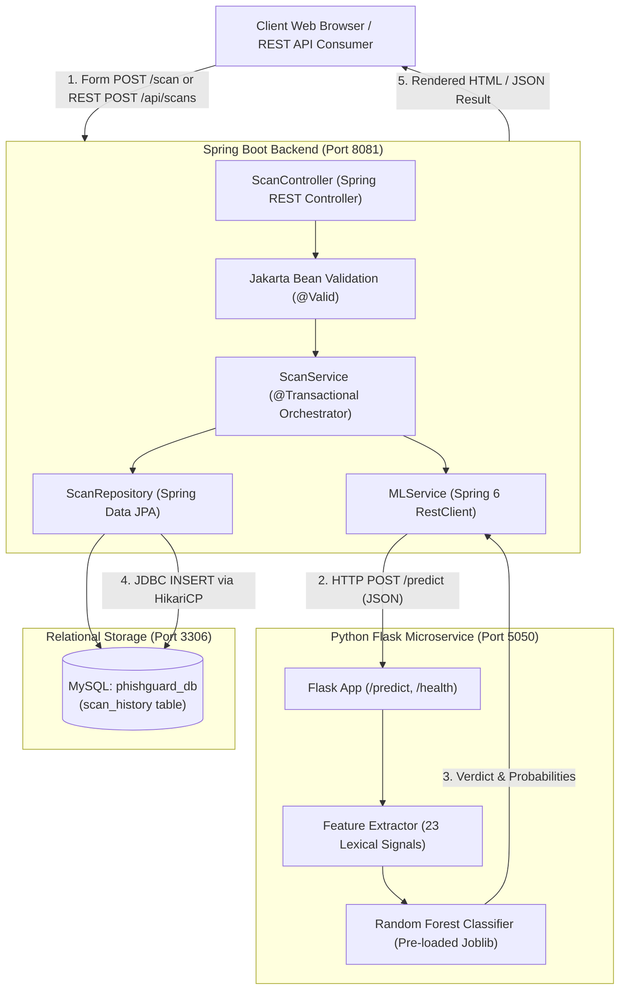
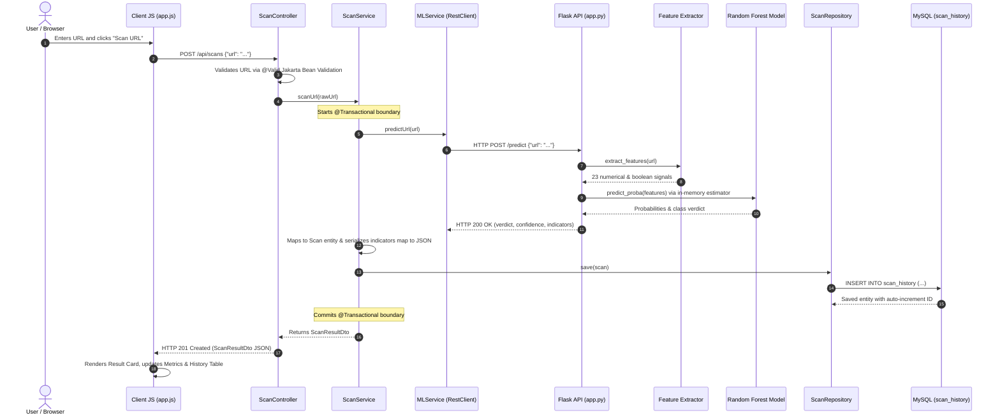
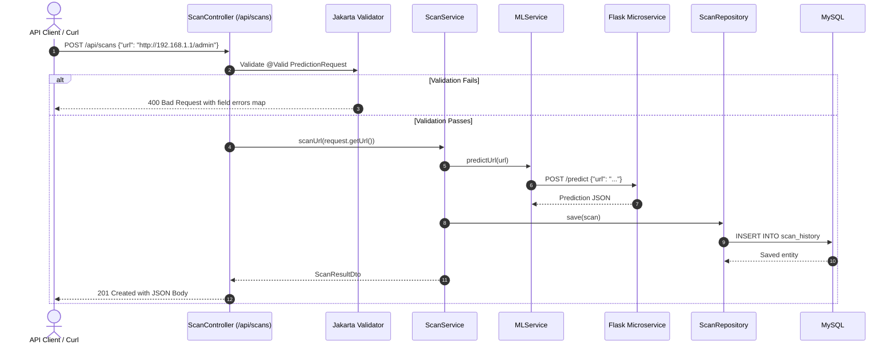
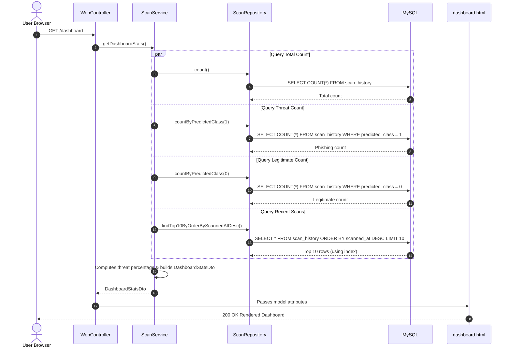
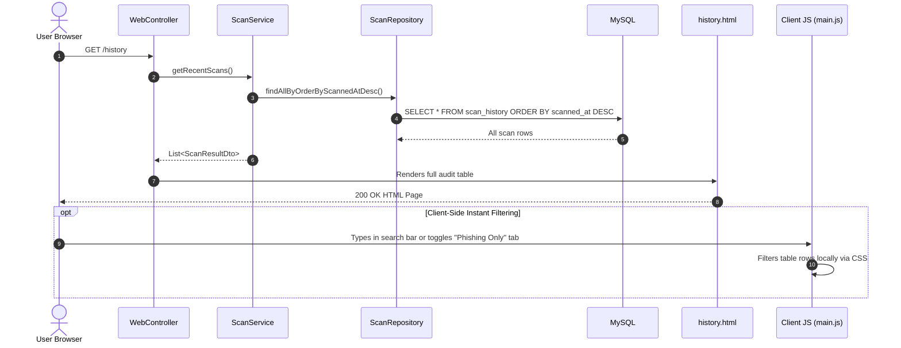
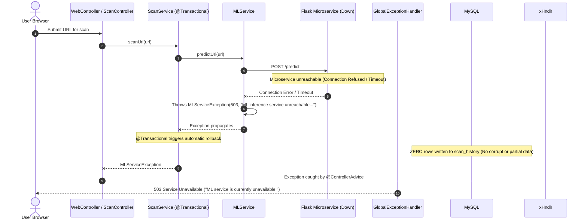

# PhishGuard — Complete Architecture, File Catalog & Workflow Guide

> **Project Name**: PhishGuard — Real-Time Phishing URL Detection & Threat Intelligence System  
> **Target Audience**: Team Members, Evaluators & Technical Presenters  
> **Tech Stack**: Java 21, Spring Boot 3.3.4, Hibernate ORM, MySQL 8+, Python 3.9, Flask, Scikit-learn, Vanilla HTML/CSS/JS  
> **Repository Root**: `PhishGuard/`

---

## Table of Contents
1. [Quick Setup & Run Commands](#1-quick-setup--run-commands)
2. [High-Level Distributed Architecture](#2-high-level-distributed-architecture)
3. [Exhaustive File-by-File Directory Catalog](#3-exhaustive-file-by-file-directory-catalog)
   - [Root Files](#31-root-files)
   - [Spring Boot Backend Files](#32-spring-boot-backend-files)
   - [Python ML Service Files](#33-python-ml-service-files)
4. [Step-by-Step System Workflows](#4-step-by-step-system-workflows)
   - [Workflow A: End-to-End Web Scan](#workflow-a-end-to-end-web-scan)
   - [Workflow B: Headless REST API](#workflow-b-headless-rest-api)
   - [Workflow C: Threat Intelligence Dashboard](#workflow-c-threat-intelligence-dashboard)
   - [Workflow D: Audit History & Instant Filtering](#workflow-d-audit-history--instant-filtering)
   - [Workflow E: Fault Tolerance & Graceful Degradation](#workflow-e-fault-tolerance--graceful-degradation)
5. [Database Design & Schema (MySQL & JPA)](#5-database-design--schema-mysql--jpa)
6. [Machine Learning Engine & 23 Lexical Indicators](#6-machine-learning-engine--23-lexical-indicators)
7. [Live Demonstration & Viva Checklist](#7-live-demonstration--viva-checklist)

---

## 1. Quick Setup & Run Commands

PhishGuard consists of two coordinated services plus a MySQL relational database.

### Prerequisites
Ensure MySQL is running on `localhost:3306`:
```bash
brew services start mysql
```

---

### Terminal 1: Python Flask ML Service
```bash
cd /Users/ashutoshkulkarni/Desktop/PhishGuard/ml-service
source venv/bin/activate
python app.py
```
* **Status**: Listens on `http://127.0.0.1:5050`
* **Health Check**: `GET http://127.0.0.1:5050/health`
* **Inference Endpoint**: `POST http://127.0.0.1:5050/predict`

---

### Terminal 2: Spring Boot Enterprise Backend
```bash
cd /Users/ashutoshkulkarni/Desktop/PhishGuard/spring-backend
./mvnw spring-boot:run
```
*(Or `mvn spring-boot:run`)*
* **Status**: Listens on `http://localhost:8081` (reads `.env` automatically)
* **Web UI (Home)**: `http://localhost:8081/`
* **System Status API**: `http://localhost:8081/api/scans/status`
* **Dashboard Stats API**: `http://localhost:8081/api/scans/dashboard`

---

## 2. High-Level Distributed Architecture



---

## 3. Exhaustive File-by-File Directory Catalog

### 3.1 Root Files
| File Path | Description & Purpose |
| :--- | :--- |
| `README.md` | Primary entry point with architecture summary, port coordinates, and macOS quick start commands. |
| `PHISHGUARD_TEAM_GUIDE.md` | This document — complete project walkthrough, file catalog, database schema, and workflow diagrams. |
| `phishguard_comprehensive_documentation.md` | Academic and technical report containing theoretical background, training benchmarks, and viva presentation notes. |
| `.gitignore` | Excludes OS caches (`.DS_Store`), IDE settings, compiled classes (`target/`), and local environment variables (`.env`). |

---

### 3.2 Spring Boot Backend Files (`spring-backend/`)

#### A. Core & Bootstrap
| File Path | Purpose |
| :--- | :--- |
| `src/main/java/com/phishguard/PhishGuardApplication.java` | Spring Boot main class. Includes custom `loadDotenv()` method which reads `spring-backend/.env` on startup to inject environment variables into JVM system properties. |

#### B. Model Layer (JPA Entity & DTOs)
| File Path | Purpose |
| :--- | :--- |
| `src/main/java/com/phishguard/model/Scan.java` | JPA Entity mapped to `scan_history` in MySQL. Defines columns (`url`, `predictedClass`, `confidence`, `riskLabel`, `scannedAt`, `indicatorsJson`), `@PrePersist` timestamp hook, and database indexes. |
| `src/main/java/com/phishguard/model/dto/PredictionRequest.java` | Carries user URL input with Jakarta validation rules (`@NotBlank`, `@Size(max=2048)`, regex URL validation). |
| `src/main/java/com/phishguard/model/dto/PredictionResponse.java` | Deserializes the JSON response payload received from the Python Flask microservice. |
| `src/main/java/com/phishguard/model/dto/ScanResultDto.java` | Unified response DTO delivered to frontend and REST API consumers. |
| `src/main/java/com/phishguard/model/dto/DashboardStatsDto.java` | Aggregates real-time statistics (total scans, threat counts, threat rate %, latest scans) for the dashboard. |

#### C. Service Layer
| File Path | Purpose |
| :--- | :--- |
| `src/main/java/com/phishguard/service/ScanService.java` | Core business service wrapped in `@Transactional`. Calls `MLService`, maps results to `Scan` entity, stores audit logs in MySQL, and computes dashboard statistics. |
| `src/main/java/com/phishguard/service/MLService.java` | HTTP Client built with Spring 6 `RestClient`. Handles communication with Python Flask on port `5050`, configuring timeouts (3s connect, 5s read) and error handling. |

#### D. Controller Layer
| File Path | Purpose |
| :--- | :--- |
| `src/main/java/com/phishguard/controller/ScanController.java` | REST API controller providing `POST /api/scans`, `GET /api/scans`, `GET /api/scans/{id}`, `GET /api/scans/dashboard`, and `GET /api/scans/status` (health probe). |

#### E. Repository Layer
| File Path | Purpose |
| :--- | :--- |
| `src/main/java/com/phishguard/repository/ScanRepository.java` | Spring Data JPA interface providing CRUD operations and custom derived query methods (`findAllByOrderByScannedAtDesc()`, `findTop10ByOrderByScannedAtDesc()`, `countByPredictedClass()`). |

#### F. Exception Handling & Error Boundaries
| File Path | Purpose |
| :--- | :--- |
| `src/main/java/com/phishguard/exception/GlobalExceptionHandler.java` | `@RestControllerAdvice` intercepting validation errors (400), downstream Flask connection failures (503), and unhandled server errors (500). |
| `src/main/java/com/phishguard/exception/MLServiceException.java` | Custom runtime exception carrying HTTP status codes (502/503) and detailed diagnostic messages. |

#### G. View Layer (Minimal Static Web UI)
| File Path | Purpose |
| :--- | :--- |
| `src/main/resources/static/index.html` | Minimal, clean single-page web interface with live scanner, verdict card, dashboard metrics, and scan history table. |
| `src/main/resources/static/css/style.css` | Clean, modern, minimalist CSS styling without unnecessary bloat. |
| `src/main/resources/static/js/app.js` | Client-side JavaScript communicating directly with Spring Boot REST API endpoints. |

#### H. Configuration & Build System
| File Path | Purpose |
| :--- | :--- |
| `src/main/resources/application.properties` | Spring properties file linking datasource, HikariCP, Hibernate DDL, and Flask URLs to environment variables. |
| `.env` | Local environment variables (`SERVER_PORT=8081`, `DB_PASSWORD=Ashutosh@3`, `ML_SERVICE_URL=http://localhost:5050`). |
| `pom.xml` | Maven build descriptor specifying dependencies (Spring Web, Validation, JPA, MySQL). |
| `mvnw` & `mvnw.cmd` | Cross-platform Maven wrapper scripts. |

---

### 3.3 Python ML Service Files (`ml-service/`)

#### A. Microservice Application
| File Path | Purpose |
| :--- | :--- |
| `app.py` | Flask REST application entry point. Implements `GET /health` and `POST /predict`, extracts 23 lexical indicators, invokes the Random Forest model, and returns JSON. |
| `.env` | Environment configuration (`FLASK_HOST=127.0.0.1`, `FLASK_PORT=5050`). |
| `requirements.txt` | Pinned Python dependencies (`Flask`, `flask-cors`, `scikit-learn`, `pandas`, `numpy`, `joblib`, `python-dotenv`, `pytest`). |

#### B. Model Inference & Persistence (`model/`)
| File Path | Purpose |
| :--- | :--- |
| `model/predictor.py` | Singleton predictor class that pre-loads `phishguard_model.joblib` into memory **once** on server startup for sub-3ms inference. |
| `model/phishguard_model.joblib` | Active serialized production Random Forest model bundle (100 trees, max depth 15, trained on 507,000 URLs). |
| `model/metadata.json` & `model_meta.json` | Model metadata detailing features, class labels, and training scores. |
| `model/logistic_regression.joblib` | Baseline linear model retained for evaluation comparisons. |
| `model/decision_tree.joblib` | Single decision tree model trained for benchmarking. |
| `model/random_forest.joblib` / `selected_model.joblib` | Model artifacts generated during the training pipeline. |

#### C. Training & Feature Extraction Pipeline (`training/`)
| File Path | Purpose |
| :--- | :--- |
| `training/feature_extraction.py` | Extracts the 23 lexical features from raw URL strings offline without network connections. |
| `training/prepare_dataset.py` | Cleans raw dataset, normalizes records, and splits into train/test sets. |
| `training/train.py` | Trains Logistic Regression, Decision Tree, and Random Forest models on training features. |
| `training/evaluate_and_select.py` | Conducts 5-fold cross-validation, generates confusion matrices, and selects the best model. |
| `training/package_model.py` | Packages and serializes the winning model into `phishguard_model.joblib`. |
| `training/test_inference.py` | Command-line script to test sample predictions locally. |
| `training/test_api.py` | Smoke tests the running Flask microservice over HTTP. |

#### D. Dataset Storage (`dataset/`)
| File Path | Purpose |
| :--- | :--- |
| `dataset/phishing_site_urls.csv` | Raw source dataset containing 507k URLs. |
| `dataset/cleaned.csv` | Sanitized and deduplicated URL dataset. |
| `dataset/train.csv` & `dataset/test.csv` | 80/20 train/test split datasets. |
| `dataset/train_features.joblib` & `test_features.joblib` | Pre-extracted feature matrices for fast model re-training. |

#### E. Benchmarks & Evaluation Reports (`results/`)
| File Path | Purpose |
| :--- | :--- |
| `results/model_comparison.md` & `.csv` | Metric comparison tables (Accuracy, Precision, Recall, F1, ROC-AUC) across the three models. |
| `results/model_selection_report.md` | Formal justification detailing why Random Forest was selected over alternative models. |
| `results/cross_validation_results.csv` | Metric scores across all 5 cross-validation folds. |
| `results/confusion_matrices.txt` | Numerical breakdown of TP, FP, TN, and FN counts for all models. |
| `results/confusion_matrix_plot.png` | Visual confusion matrix heatmaps. |
| `results/model_comparison_chart.png` | Comparison chart illustrating Precision vs Recall. |

#### F. Automated Tests (`tests/`)
| File Path | Purpose |
| :--- | :--- |
| `tests/test_end_to_end.py` | 8 automated test cases covering endpoints, boundary URL inputs, and error handling. |

---

## 4. Step-by-Step System Workflows

### Workflow A: End-to-End Web Scan



1. **User Submission**: The user enters a URL or clicks a quick test button (`Google`, `GitHub`, `PayPal Phish`, `IP Phish`).
2. **REST API Call**: `app.js` issues an asynchronous `POST /api/scans` request with `{ "url": "..." }`.
3. **Bean Validation**: `ScanController` validates the URL input format with `@Valid`.
4. **Microservice Call**: `ScanService` invokes `MLService`, issuing an HTTP POST to Flask (`http://127.0.0.1:5050/predict`).
5. **Feature Extraction**: Flask derives 23 lexical signals without external network calls.
6. **Inference**: The pre-loaded Random Forest model evaluates the feature vector in **< 3ms**.
7. **Persistence**: `ScanService` saves the audit record in MySQL's `scan_history` table.
8. **Dynamic Rendering**: `app.js` immediately renders the verdict card, updates dashboard counters, and prepends the new record to the history table.

---

### Workflow B: Headless REST API



---

### Workflow C: Threat Intelligence Dashboard



---

### Workflow D: Audit History & Instant Filtering



---

### Workflow E: Fault Tolerance & Graceful Degradation



---

## 5. Database Design & Schema (MySQL & JPA)

### 5.1 Relational Table Schema: `scan_history`
```sql
CREATE TABLE IF NOT EXISTS `scan_history` (
    `id` BIGINT NOT NULL AUTO_INCREMENT,
    `url` VARCHAR(2048) NOT NULL,
    `predicted_class` INT NOT NULL COMMENT '0 = Legitimate, 1 = Phishing',
    `confidence` DOUBLE DEFAULT NULL COMMENT 'Probability score (0.0 to 1.0)',
    `risk_label` VARCHAR(50) NOT NULL COMMENT 'Categorical risk verdict: PHISHING or LEGITIMATE',
    `scanned_at` DATETIME(6) NOT NULL COMMENT 'Timestamp with microsecond precision',
    `indicators_json` TEXT DEFAULT NULL COMMENT 'Serialized JSON of 23 lexical indicators',
    PRIMARY KEY (`id`),
    INDEX `idx_scan_history_scanned_at` (`scanned_at` DESC),
    INDEX `idx_scan_history_risk_label` (`risk_label`)
) ENGINE=InnoDB DEFAULT CHARSET=utf8mb4 COLLATE=utf8mb4_unicode_ci;
```

### 5.2 Schema Details
* **Primary Key**: `id` (`BIGINT AUTO_INCREMENT`) — provides efficient 64-bit integer indexing.
* **URL Column**: `VARCHAR(2048)` accommodates standard maximum URL lengths including deep query strings.
* **Class & Confidence**: `predicted_class` (`INT`) allows efficient indexed counting; `confidence` stores raw ensemble voting probability.
* **Descending Index (`scanned_at DESC`)**: Optimizes queries for newest records, avoiding expensive filesort operations on `/dashboard` and `/history`.

---

## 6. Machine Learning Engine & 23 Lexical Indicators

### 6.1 Zero-Execution Security Philosophy
PhishGuard treats the URL strictly as an **offline text string**. It does **not**:
* Resolve target DNS records (avoiding notifying adversaries that a domain is being checked).
* Download HTML, CSS, or scripts (eliminating exposure to exploits or drive-by malware).
* Trigger cloaking defenses used by advanced phishing sites.

### 6.2 The 23 Lexical Features
| # | Feature Name | Type | Threat Description |
|---|---|---|---|
| 1 | `url_length` | Integer | Long URLs often obscure malicious domains behind lengthy prefixes. |
| 2 | `domain_length` | Integer | Long domain names often indicate Domain Generation Algorithms (DGA). |
| 3 | `path_length` | Integer | Deep paths frequently host fake login pages. |
| 4 | `has_ip_hostname` | Boolean | Raw IP addresses in hostnames (e.g. `192.168.1.1`) bypass DNS registries. |
| 5 | `has_at_symbol` | Boolean | The `@` symbol causes browsers to treat the prefix as credentials, routing to the suffix. |
| 6 | `has_suspicious_keyword`| Boolean | Flags keywords like `login`, `verify`, `account`, `banking`, `security`. |
| 7 | `is_https` | Boolean | Checks for presence of TLS transport. |
| 8 | `has_port` | Boolean | Explicit non-standard ports (e.g. `:8080`, `:8443`) are high risk. |
| 9 | `domain_has_hyphen` | Boolean | Hyphens are commonly used for brand typosquatting (e.g., `paypal-security.com`). |
| 10 | `has_double_slash_in_path` | Boolean | `//` in paths can indicate open-redirect vulnerabilities. |
| 11 | `n_subdomains` | Integer | Chained subdomains are used to evade reputation filters. |
| 12 | `count_dots` | Integer | High frequency of periods indicates complex subdomain structures. |
| 13 | `count_hyphens` | Integer | Multiple hyphens often indicate deceptive domain names. |
| 14 | `count_underscores` | Integer | Uncommon character in legitimate domain names. |
| 15 | `count_slash` | Integer | Path hierarchy depth metric. |
| 16 | `count_question_mark` | Integer | Indicates query parameter strings. |
| 17 | `count_equal` | Integer | Indicates key-value query parameters often used for credential harvesting. |
| 18 | `count_percent` | Integer | Identifies URL percent-encoding (`%20`, `%2E`) used for obfuscation. |
| 19 | `digit_ratio` | Float | High proportion of numeric digits in the domain indicates automated generation. |
| 20 | `url_entropy` | Float | Shannon entropy measuring character randomness across the entire URL. |
| 21 | `domain_entropy` | Float | Shannon entropy measuring randomness within the domain name. |
| 22 | `path_token_count` | Integer | Number of directory segments in the URL path. |
| 23 | `tld_in_path` | Boolean | TLD suffixes in paths (e.g., `/com/login`) indicate brand spoofing. |

### 6.3 Model Evaluation Summary

| Metric | Logistic Regression | Decision Tree | Random Forest (Selected) |
| :--- | :---: | :---: | :---: |
| **Accuracy** | 85.83% | 92.14% | **93.17%** |
| **Precision (Phishing)** | 86.40% | 86.84% | **92.34%** |
| **Recall (Phishing)** | 44.03% | 76.74% | **75.98%** |
| **F1-Score** | 0.5833 | 0.8140 | **0.8337** |
| **ROC-AUC** | 0.8879 | 0.8654 | **0.9634** |

* **Why Random Forest was chosen**: Evaluates 100 de-correlated decision trees with balanced class weighting. Provides high Recall to minimize missed threats while maintaining high Precision (>92%) to avoid false alarms.

---

## 7. Live Demonstration & Viva Checklist

During a project demonstration or technical presentation, showcase these key features:

1. **System Health Probe**: Navigate to `http://localhost:8081/api/scans/status` to show both Spring Boot and Python Flask reporting `UP` and `CONNECTED`.
2. **Phishing Detection Demonstration**: 
   - On `http://localhost:8081/`, click the `Chase Fake Phish` sample button.
   - Click **Analyze URL Safety** to show the cyber radar sweep animation.
   - Review the result page: red `PHISHING` badge, confidence score, flagged keywords, and the 23-indicator breakdown table.
3. **Legitimate Site Demonstration**: 
   - Submit `https://github.com`.
   - Verify the green `LEGITIMATE` badge and safe feature profile.
4. **Interactive Audit Log**: 
   - Open `/history` and demonstrate instant client-side search filtering and risk category tabs (`All`, `Phishing`, `Legitimate`).
5. **Real-Time Threat Dashboard**: 
   - Open `/dashboard` and show the total scans, detected threat percentages, and recent scans table reflecting live MySQL data.
6. **Database Verification**: 
   - Run in MySQL Workbench or terminal:
     ```sql
     SELECT id, url, risk_label, confidence, scanned_at FROM phishguard_db.scan_history ORDER BY id DESC LIMIT 5;
     ```
7. **Fault Tolerance & Resilience Demonstration**: 
   - Stop the Flask server (`Ctrl+C` in Terminal 1).
   - Attempt a scan from the browser.
   - Show the clean `503 Service Unavailable` error page.
   - Verify in MySQL that no corrupted or incomplete rows were written to the database.
