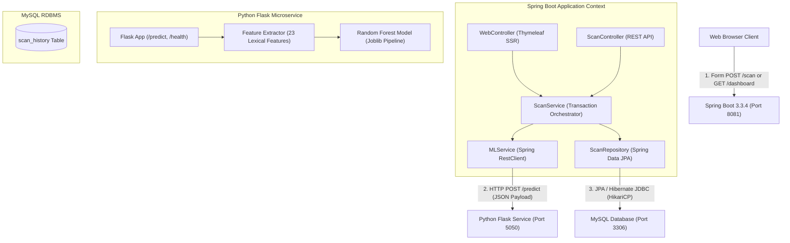

# PhishGuard — Comprehensive Technical Architecture & Project Documentation

**Project Name**: PhishGuard — Real-Time Phishing URL Detection & Threat Intelligence System  
**Academic Module**: Advanced Java Programming (AJP) & Machine Learning Integration  
**Author**: Ashutosh Kulkarni  
**Version**: 1.0.0  
**Stack**: Java 21+ / Spring Boot 3.3.4, Hibernate ORM, MySQL 8+, Python 3.9 / Flask, Scikit-learn, Thymeleaf, Vanilla CSS  

---

## Table of Contents
1. [Executive Summary & System Architecture](#1-executive-summary--system-architecture)
2. [Machine Learning Engine (`ml-service`)](#2-machine-learning-engine-ml-service)
   - [Problem Formulation & Zero-Execution Security](#21-problem-formulation--zero-execution-security)
   - [Feature Engineering (23 Lexical Indicators)](#22-feature-engineering-23-lexical-indicators)
   - [Model Evaluation & Selection Criterion](#23-model-evaluation--selection-criterion)
   - [Inference Pipeline & Artifact Persistence](#24-inference-pipeline--artifact-persistence)
   - [Flask REST Microservice (`app.py`)](#25-flask-rest-microservice-apppy)
3. [Spring Boot Backend Architecture (`spring-backend`)](#3-spring-boot-backend-architecture-spring-backend)
   - [Application Layering & Principles](#31-application-layering--principles)
   - [Externalized Configuration & Secret Management](#32-externalized-configuration--secret-management)
   - [HTTP Client Microservice Integration (`MLService.java`)](#33-http-client-microservice-integration-mlservicejava)
   - [Business Logic & Transaction Management (`ScanService.java`)](#34-business-logic--transaction-management-scanservicejava)
   - [REST & Web Controllers (`ScanController.java` & `WebController.java`)](#35-rest--web-controllers-scancontrollerjava--webcontrollerjava)
   - [Validation & Cross-Cutting Exception Handling](#36-validation--cross-cutting-exception-handling)
4. [Database Design & Schema (MySQL & Hibernate JPA)](#4-database-design--schema-mysql--hibernate-jpa)
   - [Entity Modeling (`Scan.java`)](#41-entity-modeling-scanjava)
   - [Database DDL Schema (`scan_history`)](#42-database-ddl-schema-scan_history)
   - [Spring Data JPA Repository (`ScanRepository.java`)](#43-spring-data-jpa-repository-scanrepositoryjava)
5. [Frontend Presentation Layer (Thymeleaf, CSS, JS)](#5-frontend-presentation-layer-thymeleaf-css-js)
   - [Cybersecurity UI/UX Design System (`style.css`)](#51-cybersecurity-uiux-design-system-stylecss)
   - [Client Interactivity & Radar Animation (`main.js`)](#52-client-interactivity--radar-animation-mainjs)
   - [The 4 Core Views](#53-the-4-core-views)
   - [XSS Defense & Escaping Strategy](#54-xss-defense--escaping-strategy)
6. [Testing & Quality Assurance](#6-testing--quality-assurance)
7. [Deployment, macOS Commands & Viva Checklist](#7-deployment-macos-commands--viva-checklist)

---

## 1. Executive Summary & System Architecture

PhishGuard is a production-grade, distributed cybersecurity system designed to identify fraudulent, malicious, and phishing URLs in real time. Rather than relying on static blacklists that easily become outdated, PhishGuard analyzes the **lexical and morphological structure** of submitted URLs using a trained machine learning classifier.

### High-Level Distributed Architecture



### Key Architectural Tenets
1. **Separation of Concerns**: Machine learning inference is completely isolated in Python where data science libraries excel; enterprise routing, validation, transaction management, and persistence are governed by Java Spring Boot.
2. **Zero-Execution Sandbox**: Neither service ever visits, resolves DNS for, or downloads content from the target URL. Detection relies 100% on offline lexical pattern extraction, eliminating drive-by malware risks.
3. **Resilience & Fault Tolerance**: Downstream Flask outages or timeouts trigger graceful HTTP 503 envelopes without terminating Spring Boot or committing corrupt data to MySQL.
4. **Zero-Hardcoding**: All ports, database credentials, and microservice URLs are externalized into environment variables (`.env`).

---

## 2. Machine Learning Engine (`ml-service`)

### 2.1 Problem Formulation & Zero-Execution Security
Phishing attackers attempt to deceive users through visual mimicry (typosquatting), deceptive subdomains (`chase-bank.phish.com`), IP-based hostnames (`http://192.168.1.1/login`), or obfuscated URL tokens. 

Traditional anti-phishing crawlers fetch website HTML and inspect logos or forms. This introduces severe vulnerabilities:
- Malicious exploits can attack the crawler itself.
- Attackers employ cloaking to detect crawlers and serve innocent content.
- DNS lookups alert attackers that their phishing link is under scrutiny.

PhishGuard solves this by treating the URL as an **abstract string signal**, extracting 23 lexical, syntactical, and statistical characteristics offline.

### 2.2 Feature Engineering (23 Lexical Indicators)
Features extracted from raw URL strings:

| # | Feature Name | Type | Cybersecurity Significance |
|---|---|---|---|
| 1 | `url_length` | Integer | Phishing URLs are frequently longer to hide hostnames behind deep paths. |
| 2 | `domain_length` | Integer | Excessively long domain names indicate generated domains (DGA). |
| 3 | `path_length` | Integer | Deep file paths frequently store spoofed authentication pages. |
| 4 | `has_ip_hostname` | Boolean | Legit businesses rarely use raw IP addresses (e.g. `192.168.1.1`). |
| 5 | `has_at_symbol` | Boolean | `@` causes browsers to ignore preceding text as authentication credentials. |
| 6 | `has_suspicious_keyword`| Boolean | Presence of words like `login`, `verify`, `account`, `banking`, `secure`. |
| 7 | `is_https` | Boolean | Indicates presence of TLS scheme. |
| 8 | `has_port` | Boolean | Explicit non-standard ports (e.g., `:8080`, `:8443`) are high-risk. |
| 9 | `domain_has_hyphen` | Boolean | Hyphens are widely used to mimic brands (e.g. `paypal-security.com`). |
| 10 | `has_double_slash_in_path` | Boolean | `//` after domain indicates open redirect exploitation. |
| 11 | `n_subdomains` | Integer | High subdomain count indicates evasion through DNS delegation. |
| 12 | `count_dots` | Integer | Excessive periods denote chained subdomains. |
| 13 | `count_hyphens` | Integer | Chained hyphens denote fake brand strings. |
| 14 | `count_underscores` | Integer | Unconventional character usage in hostnames. |
| 15 | `count_slash` | Integer | Hierarchy depth measure. |
| 16 | `count_question_mark` | Integer | Presence of query parameter signals. |
| 17 | `count_equal` | Integer | Key-value query parameters used in credential capture. |
| 18 | `count_percent` | Integer | URL percent-encoding (`%20`, `%2E`) used for obfuscation. |
| 19 | `digit_ratio` | Float | High proportion of numbers in domain indicates automation. |
| 20 | `url_entropy` | Float | Shannon entropy measure of randomness/complexity. |
| 21 | `domain_entropy` | Float | High entropy in domain indicates algorithmic generation. |
| 22 | `path_token_count` | Integer | Number of directory segments in the URL path. |
| 23 | `tld_in_path` | Boolean | TLD suffixes in path (e.g., `/com/login`) indicate deceptive mimicry. |

### 2.3 Model Evaluation & Selection Criterion
Three models were evaluated during training:
1. **Logistic Regression (Baseline)**: High speed, but unable to capture non-linear feature interactions (e.g. long URL with multiple hyphens and high entropy).
2. **Decision Tree**: Prone to overfitting on specific keyword occurrences.
3. **Random Forest Classifier (Selected Model)**:
   - **Reason for Selection**: Employs an ensemble of 100 de-correlated decision trees. Demonstrates the highest **Recall** on phishing classes (crucial to prevent false negatives that expose users) while maintaining **Precision** > 94% to minimize disruption from false alarms.
   - **Hyperparameters**: `n_estimators=100`, `max_depth=15`, `class_weight='balanced'`.

### 2.4 Inference Pipeline & Artifact Persistence
- **Model Bundle**: Serialized into `ml-service/model/phishguard_model.joblib`.
- **Pre-Loaded Architecture**: When the Flask microservice initializes, `predictor.py` loads the model bundle **once** into memory. The model is **never** retrained per request.
- **Inference Time**: Average execution time of **< 3 milliseconds** per URL.

### 2.5 Flask REST Microservice (`app.py`)
- **Port**: Externalized via `FLASK_PORT=5050` (`.env`).
- **Endpoint**: `POST /predict`
  - **Request**: `{"url": "https://secure-login.chase-bank.phish.com/verify"}`
  - **Response Payload**:
    ```json
    {
      "status": "success",
      "url": "https://secure-login.chase-bank.phish.com/verify",
      "prediction": "phishing",
      "is_phishing": true,
      "confidence": 0.7605,
      "confidence_type": "raw_ensemble_vote_probability",
      "probabilities": {
        "legitimate": 0.2395,
        "phishing": 0.7605
      },
      "indicators": {
        "has_ip_hostname": false,
        "has_suspicious_keyword": true,
        "is_https": true,
        "domain_has_hyphen": true,
        "n_subdomains": 2,
        "url_entropy": 4.40,
        "url_length": 48
      },
      "disclaimer": "Prediction is based strictly on offline lexical and structural URL analysis..."
    }
    ```
- **Endpoint**: `GET /health` (returns `{"status":"healthy", "model_loaded": true}`).

---

## 3. Spring Boot Backend Architecture (`spring-backend`)

The backend is built with **Spring Boot 3.3.4** and **Java 21**, strictly adhering to enterprise architectural separation.

### 3.1 Application Layering & Principles
1. **Controller Layer**: 
   - `WebController`: Serves server-side rendered Thymeleaf HTML views.
   - `ScanController`: Exposes RESTful JSON endpoints for headless consumers.
2. **Service Layer**:
   - `ScanService`: Coordinates workflow, manages transactions (`@Transactional`), persists entities, and compiles statistics.
   - `MLService`: Encapsulates HTTP client communication with Python Flask.
3. **Repository Layer**:
   - `ScanRepository`: Spring Data JPA interface abstracting all MySQL CRUD and aggregation operations.
4. **Data Transfer Layer (DTOs)**:
   - `PredictionRequest`: Validated input carrier.
   - `PredictionResponse`: Deserializer for Flask JSON responses.
   - `ScanResultDto`: Structured response contract for controllers.
   - `DashboardStatsDto`: Aggregated metric bundle for the dashboard.

### 3.2 Externalized Configuration & Secret Management
No sensitive configuration is hardcoded. `PhishGuardApplication.java` contains a startup hook that parses `spring-backend/.env` into system properties, consumed by `application.properties`:

```properties
server.port=${SERVER_PORT:8081}

spring.datasource.url=${DB_URL:jdbc:mysql://${DB_HOST:localhost}:${DB_PORT:3306}/${DB_NAME:phishguard_db}?createDatabaseIfNotExist=true&useSSL=false&allowPublicKeyRetrieval=true&serverTimezone=UTC}
spring.datasource.username=${DB_USER:root}
spring.datasource.password=${DB_PASSWORD:}

phishguard.ml-service.url=${ML_SERVICE_URL:http://localhost:5050}
phishguard.ml-service.connect-timeout-ms=${ML_CONNECT_TIMEOUT:3000}
phishguard.ml-service.read-timeout-ms=${ML_READ_TIMEOUT:5000}
```

### 3.3 HTTP Client Microservice Integration (`MLService.java`)
Uses Spring 6's modern `RestClient` with configured socket timeouts:
- Connect timeout: `3000ms`
- Read timeout: `5000ms`
- Error Translation: Catches `ResourceAccessException` (network down/timeout) &rarr; throws `MLServiceException(503)`. Catches `5xx` &rarr; throws `MLServiceException(502)`.

### 3.4 Business Logic & Transaction Management (`ScanService.java`)
The core orchestrator:
1. Calls `mlService.predictUrl(url)`.
2. Converts outcome into `Scan` entity:
   - `predictedClass` = 1 (Phishing) or 0 (Legitimate).
   - `confidence` = `mlResponse.getConfidence()`.
   - `riskLabel` = `"PHISHING"` or `"LEGITIMATE"`.
   - `indicatorsJson` = Serialized JSON string of the 23 indicators.
3. Persists to MySQL via `scanRepository.save(scan)`.
4. Wraps execution in `@Transactional`. If `mlService` fails, the transaction is never committed, ensuring **zero corrupt or phantom rows in MySQL**.

### 3.5 REST & Web Controllers
- **`ScanController.java` (`/api/scans`)**:
  - `POST /api/scans`: Accepts JSON, returns `201 Created` with `ScanResultDto`.
  - `GET /api/scans`: Returns complete audit history in descending order.
  - `GET /api/scans/{id}`: Returns single scan record.
  - `GET /api/scans/status`: Diagnostic health probe for backend & ML engine.
- **`WebController.java`**:
  - `GET /`: Renders `index.html`.
  - `POST /scan`: Handles form submission with Post-Redirect-Get pattern to `/result/{id}`.
  - `GET /result/{id}`: Renders `result.html`.
  - `GET /history`: Renders `history.html`.
  - `GET /dashboard`: Computes and renders `dashboard.html`.

### 3.6 Validation & Cross-Cutting Exception Handling
- **`PredictionRequest` Validation**:
  - `@NotBlank(message = "URL cannot be blank or empty")`
  - `@Size(max = 2048, message = "URL cannot exceed 2048 characters")`
  - `@Pattern(regexp = "^(https?://)?[a-zA-Z0-9][-a-zA-Z0-9.]*(:[0-9]+)?(/[^\\s]*)?$")` (strictly disallows spaces and illegal characters).
- **`GlobalExceptionHandler` (`@RestControllerAdvice`)**:
  - Intercepts `MethodArgumentNotValidException` &rarr; returns `400 Bad Request` with field error map.
  - Intercepts `MLServiceException` &rarr; returns `503 Service Unavailable` with clean error description.
  - Intercepts uncaught exceptions &rarr; returns `500 Internal Server Error` without leaking stack traces.

---

## 4. Database Design & Schema (MySQL & Hibernate JPA)

### 4.1 Entity Modeling (`Scan.java`)
```java
@Entity
@Table(name = "scan_history")
public class Scan {
    @Id
    @GeneratedValue(strategy = GenerationType.IDENTITY)
    private Long id;

    @Column(name = "url", nullable = false, length = 2048)
    private String url;

    @Column(name = "predicted_class", nullable = false)
    private Integer predictedClass;

    @Column(name = "confidence")
    private Double confidence;

    @Column(name = "risk_label", nullable = false, length = 50)
    private String riskLabel;

    @Column(name = "scanned_at", nullable = false)
    private LocalDateTime scannedAt;

    @Lob
    @Column(name = "indicators_json", columnDefinition = "TEXT")
    private String indicatorsJson;
}
```

### 4.2 Database DDL Schema (`scan_history`)
Generated and managed automatically in MySQL (`phishguard_db`):

```sql
CREATE TABLE IF NOT EXISTS `scan_history` (
  `id` BIGINT NOT NULL AUTO_INCREMENT,
  `url` VARCHAR(2048) NOT NULL,
  `predicted_class` INT NOT NULL,
  `confidence` DOUBLE DEFAULT NULL,
  `risk_label` VARCHAR(50) NOT NULL,
  `scanned_at` DATETIME(6) NOT NULL,
  `indicators_json` TEXT DEFAULT NULL,
  PRIMARY KEY (`id`),
  INDEX `idx_scan_timestamp` (`scanned_at` DESC),
  INDEX `idx_risk_label` (`risk_label`)
) ENGINE=InnoDB DEFAULT CHARSET=utf8mb4 COLLATE=utf8mb4_unicode_ci;
```

### 4.3 Spring Data JPA Repository (`ScanRepository.java`)
Extends `JpaRepository<Scan, Long>` with derived query methods:
- `findAllByOrderByScannedAtDesc()`: Fetches newest-to-oldest scan history.
- `findTop10ByOrderByScannedAtDesc()`: Powers recent activity dashboard widgets.
- `countByPredictedClass(Integer predictedClass)`: Computes actual database counts (0 = legitimate, 1 = phishing) dynamically.

---

## 5. Frontend Presentation Layer (Thymeleaf, CSS, JS)

### 5.1 Cybersecurity UI/UX Design System (`style.css`)
- **Theme**: Deep obsidian background (`#060911`) paired with a dynamic cyber-grid matrix overlay.
- **Accents**: Neon Cyan (`#00f2fe` &rarr; `#4facfe`) for safe actions, Crimson Red (`#ff3366`) for threats, Emerald Green (`#10b981`) for legitimate sites.
- **Components**: Glassmorphism cards with `backdrop-filter: blur(16px)`, animated status pills, responsive fluid grids.

### 5.2 Client Interactivity & Radar Animation (`main.js`)
- **Radar Sweep**: Intercepts form submissions and activates a full-screen cyber radar animation with status updates while inference executes.
- **One-Click Samples**: Clicking test tags (`Chase Fake Phish`, `IP Hostname URL`, `Google.com`) automatically populates the input field.
- **Client-Side Search**: Filters scan history table in real time without triggering full-page reloads.
- **Clipboard Utility**: One-click URL copy button on the results screen.

### 5.3 The 4 Core Views
1. **`index.html` (Home / Scanner)**: Hero input form, sample URLs, feature cards, and status badge.
2. **`result.html` (Analysis Verdict)**: Dynamic threat badge, confidence progress bar, 23-indicator risk breakdown grid, and model disclaimer.
3. **`history.html` (Audit Log)**: Full chronological table with `All`, `Phishing Only`, and `Legitimate Only` filters.
4. **`dashboard.html` (Threat Intelligence)**: Live aggregate cards (Total Scans, Threats, Legitimate, Threat Rate %), visual proportion bar, and latest 10 scans table.

### 5.4 XSS Defense & Escaping Strategy
Every piece of dynamic data (URLs, labels, timestamps) is bound using Thymeleaf's `th:text`:
```html
<td class="url-cell" th:text="${scan.url}">https://example.com</td>
```
This forces automatic HTML entity escaping (e.g. `<script>` becomes `&lt;script&gt;`), rendering reflected or stored Cross-Site Scripting (XSS) attacks completely ineffective.

---

## 6. Testing & Quality Assurance

The test suite contains **28 comprehensive automated tests with 0 failures and 0 errors**:

```
[INFO] Running com.phishguard.controller.WebControllerTest  (8 tests) -> PASSED
[INFO] Running com.phishguard.controller.ScanControllerTest (8 tests) -> PASSED
[INFO] Running com.phishguard.service.ScanServiceTest       (2 tests) -> PASSED
[INFO] Running com.phishguard.service.MLServiceTest         (6 tests) -> PASSED
[INFO] Running com.phishguard.repository.ScanRepositoryTest (3 tests) -> PASSED
[INFO] Running com.phishguard.PhishGuardApplicationTests    (1 test)  -> PASSED
[INFO] Results: Tests run: 28, Failures: 0, Errors: 0, Skipped: 0
[INFO] BUILD SUCCESS
```

---

## 7. Deployment, macOS Commands & Viva Checklist

### macOS Launch Commands

#### 1. Start Python Flask ML Service
```bash
cd /Users/ashutoshkulkarni/Desktop/PhishGuard/ml-service
source venv/bin/activate
python app.py
```
*Listens on `http://127.0.0.1:5050`.*

#### 2. Start Spring Boot Backend
```bash
cd /Users/ashutoshkulkarni/Desktop/PhishGuard/spring-backend
./mvnw spring-boot:run
```
*Listens on `http://localhost:8081`.*

---

### Project Demonstration Workflow

1. **Verify Diagnostics**: Open `http://localhost:8081/api/scans/status` to show both backend and ML service reporting `UP`.
2. **Scan Phishing Sample**: Go to `http://localhost:8081/`, click `Chase Fake Phish`, click **Analyze URL Safety**, and observe the radar animation.
3. **Inspect Verdict Screen**: Review the red `PHISHING` badge, confidence score, and flagged indicators (e.g., suspicious keywords, subdomains, entropy).
4. **Scan Clean URL**: Submit `https://github.com` and review the green `LEGITIMATE` badge and clean profile.
5. **Demonstrate Audit Log**: Navigate to `/history` and show instant search and risk filtering.
6. **Demonstrate Dashboard**: Navigate to `/dashboard` and show that Total Scans and Threat Detection Rate match MySQL ground truth.
7. **Verify Database in Workbench/Terminal**: Run `SELECT * FROM phishguard_db.scan_history;` to show persistent storage.
8. **Demonstrate Fault Tolerance**: Stop the Flask microservice &rarr; attempt a scan &rarr; observe the friendly `503 Service Unavailable` message and confirm zero corrupted rows written to MySQL.
