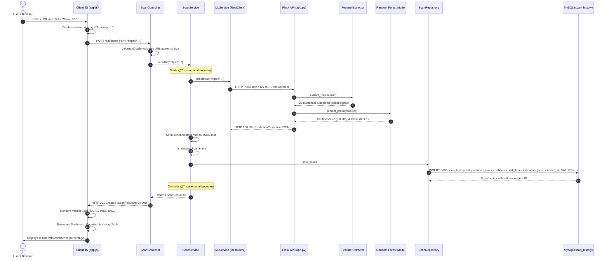
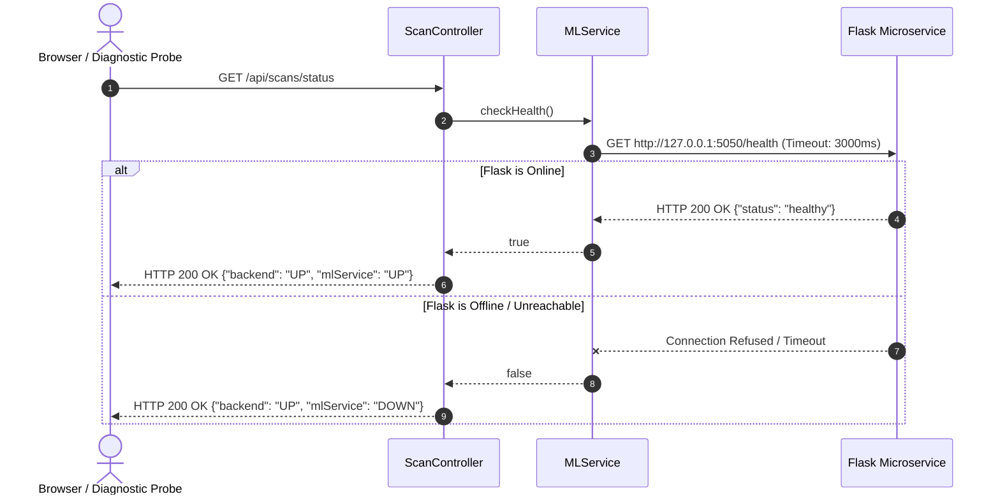
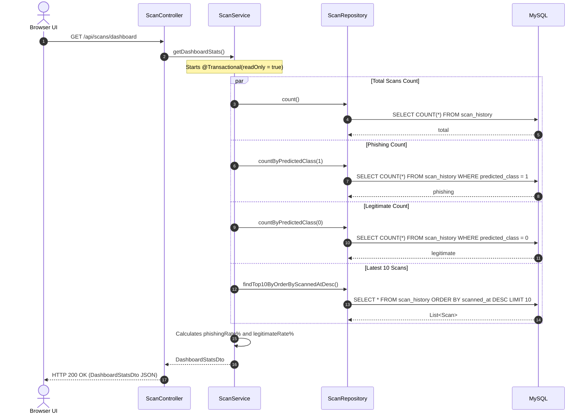
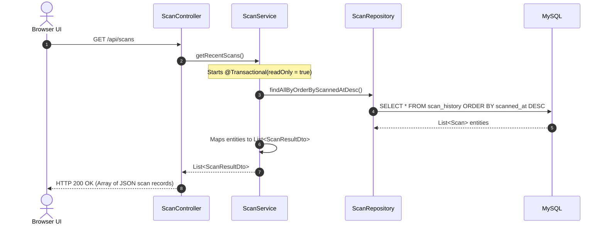
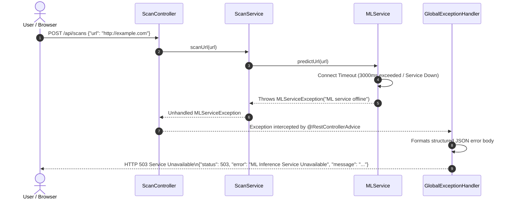

# PhishGuard — Spring Boot Backend Guide: Architecture, File Catalog & Workflows

> **Component**: `spring-backend`  
> **Architecture**: Model-View-Controller (MVC) + Layered Service-Repository Pattern  
> **Tech Stack**: Java 21, Spring Boot 3.3.4, Spring Data JPA, Hibernate 6, MySQL 8+, HikariCP, Vanilla HTML/CSS/JS  
> **Location**: `/Users/ashutoshkulkarni/Desktop/PhishGuard/spring-backend`

---

## Table of Contents
1. [Backend Overview & Architectural Pattern](#1-backend-overview--architectural-pattern)
2. [Exhaustive File-by-File Catalog](#2-exhaustive-file-by-file-catalog)
   - [2.1 Configuration & Build Files](#21-configuration--build-files)
   - [2.2 Application Bootstrapping](#22-application-bootstrapping)
   - [2.3 Controller Layer (C in MVC)](#23-controller-layer-c-in-mvc)
   - [2.4 Model Layer (M in MVC — Entities & DTOs)](#24-model-layer-m-in-mvc--entities--dtos)
   - [2.5 Service Layer (Business Logic & Orchestration)](#25-service-layer-business-logic--orchestration)
   - [2.6 Repository Layer (Data Persistence with JPA)](#26-repository-layer-data-persistence-with-jpa)
   - [2.7 Centralized Exception Handling](#27-centralized-exception-handling)
   - [2.8 View Layer (V in MVC — Minimal Static Frontend)](#28-view-layer-v-in-mvc--minimal-static-frontend)
3. [End-to-End System Workflows](#3-end-to-end-system-workflows)
   - [Workflow 1: End-to-End URL Scanning Workflow](#workflow-1-end-to-end-url-scanning-workflow)
   - [Workflow 2: System Health Probe Workflow](#workflow-2-system-health-probe-workflow)
   - [Workflow 3: Real-Time Dashboard Statistics Workflow](#workflow-3-real-time-dashboard-statistics-workflow)
   - [Workflow 4: Scan Audit History Retrieval](#workflow-4-scan-audit-history-retrieval)
   - [Workflow 5: Fault Tolerance & Graceful Exception Handling](#workflow-5-fault-tolerance--graceful-exception-handling)
4. [Database Design & Schema Definition](#4-database-design--schema-definition)
5. [Spring Annotations & Viva Presentation Cheat Sheet](#5-spring-annotations--viva-presentation-cheat-sheet)

---

## 1. Backend Overview & Architectural Pattern

The `spring-backend` serves as the central orchestrator and business intelligence engine for PhishGuard. It operates on a **Model-View-Controller (MVC)** architectural foundation decoupled with an enterprise **Service-Repository** pattern:

```mermaid
flowchart TB
    Client["Client Browser (Minimal Static View)"]

    subgraph ControllerLayer ["1. Controller Layer (C in MVC)"]
        ScanCtrl["ScanController\n(@RestController · /api/scans)"]
        Validation["Jakarta Bean Validation\n(@Valid · PredictionRequest)"]
    end

    subgraph ServiceLayer ["2. Service Layer (Business Logic)"]
        ScanSvc["ScanService\n(@Service · @Transactional)"]
        MLSvc["MLService\n(Spring 6 RestClient)"]
    end

    subgraph ModelLayer ["3. Model Layer (M in MVC)"]
        ScanEntity["Scan Entity\n(@Entity · scan_history table)"]
        DTOs["DTOs (Data Transfer Objects)\nPredictionRequest · PredictionResponse\nScanResultDto · DashboardStatsDto"]
    end

    subgraph DataAccessLayer ["4. Repository Layer (Data Access)"]
        ScanRepo["ScanRepository\n(Spring Data JPA · JpaRepository)"]
        HikariPool["HikariCP Connection Pool\n(max-pool-size: 10)"]
    end

    subgraph ExternalServices ["External Systems"]
        FlaskML["Python Flask Microservice\n(Port 5050 · /predict & /health)"]
        MySQLDB[("MySQL Database\n(Port 3306 · phishguard_db)")]
    end

    Client -->|HTTP POST /api/scans| ScanCtrl
    ScanCtrl --> Validation
    Validation --> ScanSvc
    ScanSvc --> MLSvc
    MLSvc -->|HTTP POST /predict| FlaskML
    FlaskML -->>|JSON Prediction| MLSvc
    ScanSvc -->|Save Entity| ScanRepo
    ScanRepo --> HikariPool
    HikariPool --> MySQLDB
    ScanSvc -->>|ScanResultDto| ScanCtrl
    ScanCtrl -->>|JSON Response (201 Created)| Client
```

### Key Architectural Strengths
1. **Decoupled Responsibilities**: Controllers handle HTTP protocol semantics, Services encapsulate transactions and orchestration, Repositories isolate SQL/JPA queries, and Models define data structures.
2. **Zero View-Engine Overhead**: Rather than complex server-side engines like Thymeleaf, Spring Boot serves lightweight static HTML, CSS, and JS directly from `src/main/resources/static/`, enabling high-performance client-side rendering.
3. **Resilience & Fault Tolerance**: External ML calls are guarded with configurable HTTP connection (3s) and read (5s) timeouts. Centralized exception handling converts failures into structured JSON responses with appropriate HTTP status codes.
4. **ACID Transaction Guarantee**: Database operations are enclosed in `@Transactional` boundaries, ensuring audit records are consistently persisted or safely rolled back upon failure.

---

## 2. Exhaustive File-by-File Catalog

Every file within `spring-backend` has a precise role. Below is the comprehensive catalog:

```
spring-backend/
├── pom.xml                                      # Maven build descriptor
├── .env                                         # Local environment variables
├── README.md                                    # Backend quickstart guide
├── mvnw & mvnw.cmd                              # Maven wrappers
├── .mvn/wrapper/maven-wrapper.properties        # Maven wrapper configuration
└── src/main/
    ├── java/com/phishguard/
    │   ├── PhishGuardApplication.java           # Application entry point & .env loader
    │   ├── controller/
    │   │   └── ScanController.java              # REST API endpoints
    │   ├── model/
    │   │   ├── Scan.java                        # JPA Entity (scan_history table)
    │   │   └── dto/
    │   │       ├── PredictionRequest.java       # User input DTO with validation
    │   │       ├── PredictionResponse.java      # Flask JSON mapping DTO
    │   │       ├── ScanResultDto.java           # Unified scan result DTO
    │   │       └── DashboardStatsDto.java       # Aggregated stats DTO
    │   ├── service/
    │   │   ├── ScanService.java                 # Transactional scanning service
    │   │   └── MLService.java                   # RestClient HTTP client to Flask
    │   ├── repository/
    │   │   └── ScanRepository.java              # Spring Data JPA interface
    │   └── exception/
    │       ├── GlobalExceptionHandler.java      # Centralized error handler
    │       └── MLServiceException.java          # Custom runtime ML exception
    └── resources/
        ├── application.properties               # Spring properties & database config
        └── static/
            ├── index.html                       # Minimalist single-page frontend
            ├── css/style.css                    # Clean, lightweight CSS stylesheet
            └── js/app.js                        # Client-side JavaScript logic
```

---

### 2.1 Configuration & Build Files

#### 1. [`pom.xml`](pom.xml)
- **Role**: Root Project Object Model descriptor for Apache Maven.
- **Key Dependencies**:
  - `spring-boot-starter-web`: Embeds Apache Tomcat, registers `DispatcherServlet`, Jackson JSON converter, and Spring MVC request mappings.
  - `spring-boot-starter-validation`: Jakarta Bean Validation (`Hibernate Validator`) for incoming DTO constraints (`@NotBlank`, `@Size`, `@Pattern`).
  - `spring-boot-starter-data-jpa`: Spring Data JPA and Hibernate ORM for entity mapping, CRUD repository synthesis, and transaction handling.
  - `mysql-connector-j`: Official MySQL JDBC Type-4 driver for network protocol communication with MySQL 8+.
- **Build Plugin**: `spring-boot-maven-plugin` repackages compiled bytecode and transitive dependencies into an executable "fat JAR".

#### 2. [`.env`](.env)
- **Role**: Local key-value store for environment configuration. Prevents hardcoding database credentials or port numbers into code.
- **Variables**:
  ```ini
  SERVER_PORT=8081
  DB_HOST=localhost
  DB_PORT=3306
  DB_NAME=phishguard_db
  DB_USER=root
  DB_PASSWORD=Ashutosh@3
  JPA_DDL_AUTO=update
  JPA_SHOW_SQL=false
  ML_SERVICE_URL=http://localhost:5050
  ML_CONNECT_TIMEOUT=3000
  ML_READ_TIMEOUT=5000
  ```

#### 3. [`src/main/resources/application.properties`](src/main/resources/application.properties)
- **Role**: Primary Spring Boot application configuration file.
- **Mechanisms**:
  - Links Spring properties to `.env` variables via `${ENV_VAR:default_value}` syntax.
  - Configures the **HikariCP connection pool**: `maximum-pool-size=10`, `minimum-idle=2`, `idle-timeout=30000ms`, `connection-timeout=20000ms`.
  - Configures **Hibernate**: `MySQLDialect`, `ddl-auto=update`, `open-in-view=false` (prevents lazy-loading anti-patterns outside service boundaries).
  - Configures **External ML Client**: Base URL, endpoint paths (`/predict`, `/health`), and timeout thresholds.

---

### 2.2 Application Bootstrapping

#### [`src/main/java/com/phishguard/PhishGuardApplication.java`](src/main/java/com/phishguard/PhishGuardApplication.java)
- **Annotations**: `@SpringBootApplication` (aggregates `@Configuration`, `@EnableAutoConfiguration`, and `@ComponentScan` across package `com.phishguard`).
- **Core Functions**:
  1. `main(String[] args)`: Invokes `loadDotenv()` prior to bootstrapping the `SpringApplication` context.
  2. `loadDotenv()`: Inspects candidate locations (`.env`, `spring-backend/.env`, `../.env`). Parses key-value pairs and injects them directly into `System.setProperty()`, ensuring Spring resolves database credentials before datasource initialization.
  3. Logs active web port, database URL, and connected ML service endpoint upon startup.

---

### 2.3 Controller Layer (C in MVC)

#### [`src/main/java/com/phishguard/controller/ScanController.java`](src/main/java/com/phishguard/controller/ScanController.java)
- **Annotations**:
  - `@RestController`: Marks this class as a Spring REST Controller. Every method return value is automatically written directly to the HTTP response body via Jackson JSON serialization.
  - `@RequestMapping("/api/scans")`: Declares the root URI path for all nested routes.
  - `@CrossOrigin(origins = "*")`: Enables Cross-Origin Resource Sharing.
- **Exposed Endpoints**:
  1. `POST /api/scans`:
     - Accepts `@Valid @RequestBody PredictionRequest request`.
     - Delegates scanning to `scanService.scanUrl(request.getUrl())`.
     - Returns HTTP `201 Created` with `ScanResultDto`.
  2. `GET /api/scans`:
     - Calls `scanService.getRecentScans()`.
     - Returns HTTP `200 OK` with `List<ScanResultDto>` sorted newest to oldest.
  3. `GET /api/scans/{id}`:
     - Accepts `@PathVariable Long id`.
     - Returns HTTP `200 OK` if found, or `404 Not Found`.
  4. `GET /api/scans/dashboard`:
     - Calls `scanService.getDashboardStats()`.
     - Returns HTTP `200 OK` with `DashboardStatsDto` containing dynamic counts and threat rates.
  5. `GET /api/scans/status`:
     - Probes `mlService.checkHealth()`.
     - Returns HTTP `200 OK` with health status map (`backend: UP`, `mlService: UP/DOWN`).

---

### 2.4 Model Layer (M in MVC — Entities & DTOs)

#### 1. [`src/main/java/com/phishguard/model/Scan.java`](src/main/java/com/phishguard/model/Scan.java)
- **Role**: JPA Domain Entity mapped to the `scan_history` relational database table.
- **JPA Annotations**:
  - `@Entity`: Declares this class as a managed Hibernate persistent entity.
  - `@Table(name = "scan_history", indexes = {...})`: Configures database table name and composite indexes on `scanned_at DESC` and `risk_label` for sub-millisecond querying.
  - `@Id` & `@GeneratedValue(strategy = GenerationType.IDENTITY)`: Primary key mapped to MySQL `AUTO_INCREMENT`.
  - `@Column`: Customizes column data types, nullability, and lengths (e.g., `url` length 2048, `indicators_json` as `TEXT`).
  - `@PrePersist`: Lifecycle callback that automatically initializes `scannedAt = LocalDateTime.now()` prior to the SQL `INSERT`.
- **Fields**:
  - `Long id`: Primary key.
  - `String url`: Target URL analyzed.
  - `Integer predictedClass`: `0` for Legitimate, `1` for Phishing.
  - `Double confidence`: Confidence probability score (0.00 to 1.00).
  - `String riskLabel`: Human-readable label (`"PHISHING"`, `"LEGITIMATE"`).
  - `LocalDateTime scannedAt`: Exact timestamp of analysis.
  - `String indicatorsJson`: Serialized JSON storing the 23 lexical indicators.

#### 2. [`src/main/java/com/phishguard/model/dto/PredictionRequest.java`](src/main/java/com/phishguard/model/dto/PredictionRequest.java)
- **Role**: Inbound DTO capturing user URL input.
- **Jakarta Validation Constraints**:
  - `@NotBlank(message = "URL cannot be blank or empty")`
  - `@Size(max = 2048, message = "URL cannot exceed 2048 characters")`
  - `@Pattern(regexp = "^(https?://)?[a-zA-Z0-9][-a-zA-Z0-9.]*(:[0-9]+)?(/[^\\s]*)?$", message = "Submitted string is not a valid URL or hostname format")`

#### 3. [`src/main/java/com/phishguard/model/dto/PredictionResponse.java`](src/main/java/com/phishguard/model/dto/PredictionResponse.java)
- **Role**: Deserializes the exact JSON payload returned by Python Flask `POST /predict`.
- **Annotations**: `@JsonIgnoreProperties(ignoreUnknown = true)` prevents failures if Flask adds future metadata fields.
- **Key Fields**: `status`, `url`, `prediction`, `isPhishing`, `confidence`, `probabilities` (Map), `indicators` (Map of 23 signals), `disclaimer`.

#### 4. [`src/main/java/com/phishguard/model/dto/ScanResultDto.java`](src/main/java/com/phishguard/model/dto/ScanResultDto.java)
- **Role**: Outbound DTO sent to the frontend. Unifies the MySQL generated database ID (`scanId`) and timestamp with the ML model's confidence and lexical indicators.

#### 5. [`src/main/java/com/phishguard/model/dto/DashboardStatsDto.java`](src/main/java/com/phishguard/model/dto/DashboardStatsDto.java)
- **Role**: Encapsulates dynamic aggregate detection metrics:
  - `totalScans`: Total count of URLs scanned.
  - `phishingScans`: Count of malicious URLs detected (`predictedClass = 1`).
  - `legitimateScans`: Count of benign URLs detected (`predictedClass = 0`).
  - `phishingRate` & `legitimateRate`: Percentage ratios rounded to 1 decimal place.
  - `mlServiceOnline` & `mlServiceUrl`: Health status of the downstream microservice.
  - `recentScans`: List of latest 10 scan records.

---

### 2.5 Service Layer (Business Logic & Orchestration)

#### 1. [`src/main/java/com/phishguard/service/ScanService.java`](src/main/java/com/phishguard/service/ScanService.java)
- **Annotations**:
  - `@Service`: Declares this class as a Spring business logic component.
  - `@Transactional`: Enforces ACID boundaries on database operations.
- **Core Methods**:
  - `scanUrl(String rawUrl)`:
    1. Trims and sanitizes the URL string.
    2. Calls `mlService.predictUrl(url)` to get real-time inference from Python.
    3. Serializes the 23 lexical indicators into JSON via Jackson `ObjectMapper`.
    4. Instantiates and persists a new `Scan` entity via `scanRepository.save(scan)`.
    5. Assembles and returns `ScanResultDto` with the newly assigned database ID.
  - `getRecentScans()`: Read-only transaction (`@Transactional(readOnly = true)`) querying `scanRepository.findAllByOrderByScannedAtDesc()` and mapping entities to DTOs.
  - `getScanById(Long id)`: Retrieves a specific record by primary key.
  - `getDashboardStats()`: Dynamically calculates counts, ratios, and queries the top 10 recent scans.

#### 2. [`src/main/java/com/phishguard/service/MLService.java`](src/main/java/com/phishguard/service/MLService.java)
- **Role**: Modern HTTP client communicating with Python Flask using Spring 6's fluent `RestClient`.
- **Key Features**:
  - Configures `SimpleClientHttpRequestFactory` with strict timeouts (`connectTimeout: 3000ms`, `readTimeout: 5000ms`).
  - `predictUrl(String url)`:
    - Posts JSON payload `{"url": "..."}` to `http://localhost:5050/predict`.
    - Handles network partitions (`ResourceAccessException`), 4xx errors (`HttpClientErrorException`), and 5xx errors (`HttpServerErrorException`), wrapping them in informative `MLServiceException` instances.
  - `checkHealth()`: Sends lightweight `GET /health` request to Flask to verify microservice availability.

---

### 2.6 Repository Layer (Data Persistence with JPA)

#### [`src/main/java/com/phishguard/repository/ScanRepository.java`](src/main/java/com/phishguard/repository/ScanRepository.java)
- **Annotations**:
  - `@Repository`: Marks the interface as a Data Access Object (DAO) and activates Spring's automatic SQL exception translation.
  - Inherits `JpaRepository<Scan, Long>` for out-of-the-box CRUD (`save`, `findById`, `count`, `delete`).
- **Derived Query Methods**:
  - `findAllByOrderByScannedAtDesc()`: Generates `SELECT s FROM Scan s ORDER BY s.scannedAt DESC`.
  - `findTop10ByOrderByScannedAtDesc()`: Generates query restricted to the top 10 records for dashboard display.
  - `findByRiskLabelOrderByScannedAtDesc(String riskLabel)`: Filters records by classification label.
  - `countByPredictedClass(Integer predictedClass)`: Counts occurrences matching class `0` or `1`.

---

### 2.7 Centralized Exception Handling

#### 1. [`src/main/java/com/phishguard/exception/GlobalExceptionHandler.java`](src/main/java/com/phishguard/exception/GlobalExceptionHandler.java)
- **Annotations**: `@RestControllerAdvice`: Intercepts exceptions thrown by any `@RestController` across the application and translates them into structured JSON error payloads.
- **Handlers**:
  - `MethodArgumentNotValidException`: Returns HTTP `400 Bad Request` with an exact map of invalid fields and validation failure messages.
  - `MLServiceException`: Returns HTTP `503 Service Unavailable` or `502 Bad Gateway` when Flask ML is down or times out.
  - `IllegalArgumentException`: Returns HTTP `400 Bad Request`.
  - `Exception` (catch-all): Logs stack trace and returns clean HTTP `500 Internal Server Error` without leaking database connection details or credentials.

#### 2. [`src/main/java/com/phishguard/exception/MLServiceException.java`](src/main/java/com/phishguard/exception/MLServiceException.java)
- **Role**: Custom unchecked exception storing HTTP status codes (e.g., 502/503) and contextual error descriptions.

---

### 2.8 View Layer (V in MVC — Minimal Static Frontend)

The presentation layer is decoupled from server-side template engines. Spring Boot serves these files statically:

#### 1. [`src/main/resources/static/index.html`](src/main/resources/static/index.html)
- Clean, semantic HTML5 structure:
  - **Header**: Brand title and live system status badges (`Backend: Online`, `ML Service: Online/Offline`).
  - **Scanner Form**: URL input box and "Scan URL" submit button.
  - **Quick Test Pills**: One-click test URLs (`Google`, `GitHub`, `PayPal Phish`, `IP Phish`).
  - **Live Verdict Card**: Dynamically populated container displaying SAFE / PHISHING badge, confidence percentage, analyzed URL, and a 4-indicator grid (URL Length, IP Address presence, HTTPS protocol, Subdomain count).
  - **Metrics Cards**: 3 summary cards (Total Scans, Phishing Detected, Legitimate URLs).
  - **Audit History Table**: Tabular log displaying recent scans with timestamp and status badge, plus a "Refresh" button.

#### 2. [`src/main/resources/static/css/style.css`](src/main/resources/static/css/style.css)
- Minimalist CSS design system (< 350 lines).
- Neutral slate palette (`#f8fafc`, `#0f172a`), semantic danger red (`#dc2626`), and success green (`#16a34a`).
- Fully responsive across mobile, tablet, and desktop viewports without external frameworks.

#### 3. [`src/main/resources/static/js/app.js`](src/main/resources/static/js/app.js)
- Asynchronous client-side logic using standard `fetch()` API:
  - `checkStatus()`: Polls `/api/scans/status` and updates status badges.
  - `loadStats()`: Fetches `/api/scans/dashboard` and updates metric counters.
  - `loadHistory()`: Fetches `/api/scans` and populates the history table.
  - Form Submit Handler: Dispatches `POST /api/scans` with JSON `{ "url": "..." }`, shows loading state, displays verdict card, and refreshes metrics and history.
  - Quick Test Handlers: Automatically fills input with sample URLs when clicked.

---

## 3. End-to-End System Workflows

### Workflow 1: End-to-End URL Scanning Workflow

This is the primary operational workflow of the entire application:



---

### Workflow 2: System Health Probe Workflow



---

### Workflow 3: Real-Time Dashboard Statistics Workflow



---

### Workflow 4: Scan Audit History Retrieval



---

### Workflow 5: Fault Tolerance & Graceful Exception Handling



---

## 4. Database Design & Schema Definition

The backend uses a single, optimized relational table in MySQL named **`scan_history`**, mapped directly by `Scan.java`:

### DDL Schema (Auto-generated by Hibernate ORM)
```sql
CREATE TABLE IF NOT EXISTS `scan_history` (
    `id` BIGINT NOT NULL AUTO_INCREMENT,
    `url` VARCHAR(2048) NOT NULL,
    `predicted_class` INT NOT NULL,
    `confidence` DOUBLE DEFAULT NULL,
    `risk_label` VARCHAR(50) NOT NULL,
    `indicators_json` TEXT DEFAULT NULL,
    `scanned_at` DATETIME(6) NOT NULL,
    PRIMARY KEY (`id`),
    INDEX `idx_scan_history_scanned_at` (`scanned_at` DESC),
    INDEX `idx_scan_history_risk_label` (`risk_label`)
) ENGINE=InnoDB DEFAULT CHARSET=utf8mb4 COLLATE=utf8mb4_unicode_ci;
```

### Schema Analysis
| Column | Type | Constraints | Description |
| :--- | :--- | :--- | :--- |
| `id` | `BIGINT` | `PK`, `AUTO_INCREMENT` | Unique numeric identifier for each scan transaction. |
| `url` | `VARCHAR(2048)` | `NOT NULL` | Full target URL analyzed (supports standard max URL length). |
| `predicted_class` | `INT` | `NOT NULL` | Binary indicator: `0` = Legitimate, `1` = Phishing. |
| `confidence` | `DOUBLE` | `NULLABLE` | Probability score calculated by Random Forest (0.000 to 1.000). |
| `risk_label` | `VARCHAR(50)` | `NOT NULL` | Categorical label: `"LEGITIMATE"`, `"PHISHING"`. |
| `indicators_json` | `TEXT` | `NULLABLE` | Serialized JSON string of the 23 extracted lexical URL indicators. |
| `scanned_at` | `DATETIME(6)` | `NOT NULL` | High-precision timestamp set automatically via `@PrePersist`. |

---

## 5. Spring Annotations & Viva Presentation Cheat Sheet

Use this reference table to explain key annotations during academic evaluations and technical interviews:

| Annotation | Package | Architectural Explanation |
| :--- | :--- | :--- |
| `@SpringBootApplication` | `org.springframework.boot.autoconfigure` | Convenience annotation bundling `@Configuration` (Java-based config), `@EnableAutoConfiguration` (Spring Boot magic), and `@ComponentScan` (discovers beans under `com.phishguard`). |
| `@RestController` | `org.springframework.web.bind.annotation` | Specialized `@Controller` with implicit `@ResponseBody`. Automatically serializes Java method return objects into HTTP response JSON via Jackson. |
| `@RequestMapping` | `org.springframework.web.bind.annotation` | Maps HTTP requests to handler methods; sets the `/api/scans` prefix for all controller endpoints. |
| `@Valid` | `jakarta.validation` | Triggers Jakarta Bean Validation constraints on inbound request bodies prior to executing controller methods. |
| `@Service` | `org.springframework.stereotype` | Stereotype indicating an enterprise business service component; registers the bean in Spring's ApplicationContext. |
| `@Transactional` | `org.springframework.transaction.annotation` | Defines ACID transaction boundaries. Automatically begins a transaction and commits on method completion or rolls back on runtime exceptions. |
| `@Repository` | `org.springframework.stereotype` | Marks a Data Access Object (DAO); enables automatic translation of low-level `SQLException`s into Spring's unified `DataAccessException` hierarchy. |
| `@Entity` | `jakarta.persistence` | Marks the class as a persistent relational model managed by the Hibernate JPA entity lifecycle. |
| `@Table` | `jakarta.persistence` | Maps the entity to a specific database table (`scan_history`) and declares custom table indexes. |
| `@Id` & `@GeneratedValue` | `jakarta.persistence` | Defines the primary key and assigns the generation strategy (`GenerationType.IDENTITY` for MySQL `AUTO_INCREMENT`). |
| `@PrePersist` | `jakarta.persistence` | JPA entity lifecycle hook executed immediately before the SQL `INSERT` statement is dispatched. |
| `@RestControllerAdvice` | `org.springframework.web.bind.annotation` | Enables global cross-cutting exception interception across all REST controllers. |
| `@ExceptionHandler` | `org.springframework.web.bind.annotation` | Maps specific Java exception classes to corresponding handler methods for structured JSON error rendering. |

---

## 6. Execution Commands

### 1. Build & Package Executable JAR
```bash
cd /Users/ashutoshkulkarni/Desktop/PhishGuard/spring-backend
./mvnw clean package
```

### 2. Run Spring Boot Backend
```bash
./mvnw spring-boot:run
```
*(Application starts on port `8081` using parameters from `.env`).*

### 3. Access Web Interface
Open your web browser and navigate to:
```
http://localhost:8081/
```
